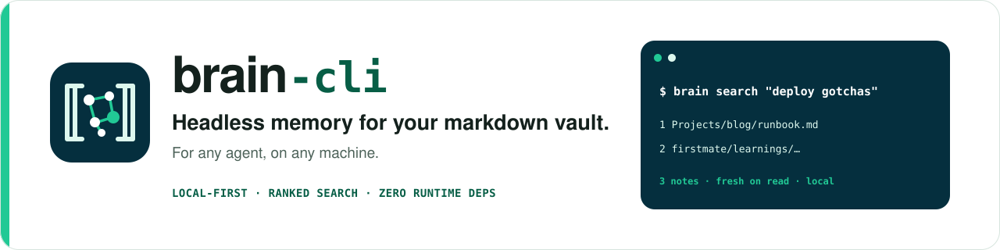
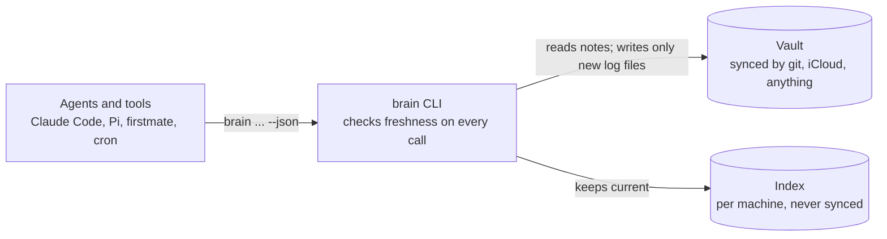

<p align="center">
  
</p>

<p align="center">
  <a href="https://github.com/phuhien92/brain-cli/actions/workflows/ci.yml"></a>
  
  
  
</p>

`brain` indexes a folder of markdown notes — an Obsidian vault, a docs folder, an agent's
learnings — and gives any agent ranked search, memory that syncs across machines, and a
warning when a note has gone stale. From the shell, with a stable JSON contract. No app
running, no API key, and your notes never leave the machine. Anonymous usage data is
off unless you say yes when brain asks, once ([telemetry](docs/telemetry.md)).

```console
$ brain search "deploy gotchas on the mac mini" --limit 3
1. firstmate/learnings/2026-10-13-pnpm-cache.md  (6.212)
   pnpm cache breaks after an OS update — …the [mac] [mini] keeps a stale store; [deploy] fails until…
2. Projects/blog/runbook.md  (4.087)
   Blog runbook — …## [Deploy] - Vercel builds from main. Known [gotchas]: preview env vars…
3. MEMORY.md  (2.951)
   …two machines: the [mac] [mini] runs the long jobs, the laptop travels…
```

## Why

Agents can already `grep` a vault, and for an exact string they should. But grep
returns *every* file that mentions a word, unranked. On a 127-note vault, "interview"
matches 61 files, and the agent pays tokens to open them to find out which ones matter.

`brain search` returns the handful that are *about* the question, ranked by BM25 with
titles, aliases and headings weighted above passing mentions, plus a snippet of where
each one matched. The agent reads three notes instead of sixty.

Obsidian has excellent search, and since 1.12 an official CLI — but it requires the
desktop app to be running. That rules it out exactly where agent memory is needed: cloud
sessions, cron jobs, and agents working on another machine over SSH. `brain` reads the
same markdown, wiki-links and frontmatter, headlessly. It does not replace Obsidian; it
is the layer agents use while Obsidian is closed.

## Install

Requires Node.js **22.13+** (it uses the built-in `node:sqlite`, so nothing compiles).

```sh
npm install -g github:phuhien92/brain-cli
brain setup        # pick your vault, machine name, sync, agents, telemetry — nothing written until you confirm
```

Agents and scripts can do the same without questions:
`brain setup --yes --vault ~/vault --agents claude,pi --telemetry no`.

## Quick start

```sh
brain search "renewal deadline"                 # ranked search, from any folder once set up
brain get "Projects/blog/runbook" --section Deploy
brain log add learning "pnpm cache breaks after macOS updates"
brain lifecycle set "Finance/balances" --category current-state --as-of 2026-09-30
brain doctor                                    # check this machine's setup
```

## How it fits together



The vault holds only markdown and stays the source of truth; the index is a per-machine
cache; brain never edits a note. Full design, with the per-command flow and where every
file lives: **[docs/architecture.md](docs/architecture.md)**.

## Documentation

| | |
| --- | --- |
| [Architecture](docs/architecture.md) | design, diagrams, guarantees, code map |
| [Indexing](docs/indexing.md) | how the index stays up to date, measured costs, limits |
| [Commands](docs/cli.md) | every command, the JSON contract, exit codes |
| [Agents](docs/agents.md) | skills and session primers for Claude Code, Pi and others |
| [Memory across machines](docs/memory.md) | one file per entry, views, export, sync |
| [Keeping the vault true](docs/lifecycle.md) | lifecycle categories, review windows, lint |
| [Integrations](docs/integrations.md) | many repos sharing one vault, scopes, sync modes |
| [firstmate guide](docs/firstmate.md) | sharing firstmate's learnings across two machines |
| [Feedback](docs/feedback.md) | bug reports and ideas from people and agents, redacted, posted only with permission |
| [Telemetry](docs/telemetry.md) | opt-in anonymous usage data: what is collected, how the one-time question works |
| [Extensions (design)](docs/design/extensions.md) | proposed plugin model and `brain ui` |

## Roadmap

1. **Core** — `index`, `search`, `get`, incremental indexing, `--json`. ✅
2. **Memory that syncs across machines** — one file per entry, generated views, `export`
   with drift protection, `import`, `sync`. First consumer:
   [firstmate](https://github.com/kunchenguid/firstmate). ✅
3. **Integrations and scopes** — named integrations with read folders and write kinds,
   `BRAIN_AS`, pluggable sync, `brain doctor`. ✅
4. **Lifecycle and lint** — review windows by category, archive, and `brain lint`. ✅
   Still to come in this step: the published benchmark of grep vs. the Obsidian CLI vs.
   `brain` on real questions, measuring tokens read and whether the right note came back.
5. **Extensions** — anyone can add a command (`brain <name>`) or a hook on brain's
   events in any language, as a separate process speaking the `--json` contract, with a
   manifest that declares what it reads, writes and contacts. Importers, embeddings and
   new views belong here, not in the core.
6. **`brain ui`** — a local web page (127.0.0.1 only) for status, integrations, this
   machine's config, extensions and a search playground, like Serena's dashboard.

Steps 5 and 6 are designed, not built: [docs/design/extensions.md](docs/design/extensions.md).

## Develop

```sh
npm install
npm test        # builds, then runs node:test over the parser, the index and the real binary
```

## License

MIT
