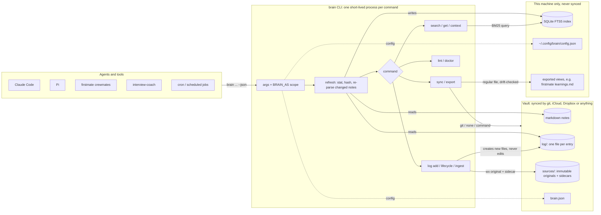
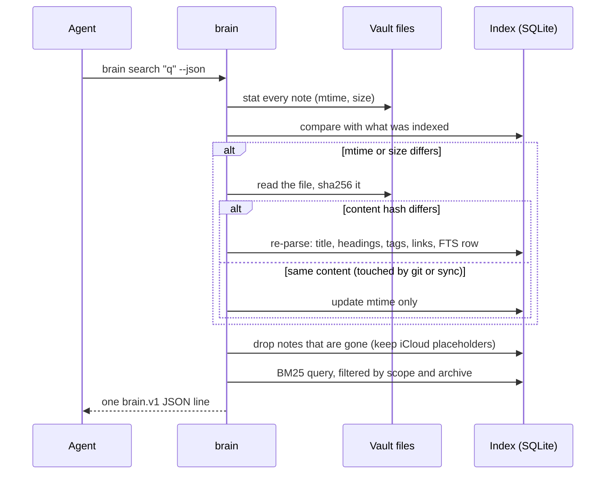

# Architecture

brain is a short-lived command, not a service. Each call reads your markdown vault,
brings a per-machine index up to date, answers, and exits. Everything below follows from
three decisions:

1. **The vault is the source of truth.** It holds markdown notes plus immutable originals
   under `sources/`. Anything else brain keeps (the index, export bookkeeping) is a
   per-machine cache that can be deleted.
2. **brain never edits a note or source.** Its only writes into the vault are *new files*
   under `log/` and `sources/`, all created exclusively. That is what makes the vault safe
   to sync by any means — git, iCloud, Dropbox — between machines.
3. **The JSON envelope is the API.** Agents, scripts and future extensions talk to brain
   through `brain … --json` and exit codes, never through its internals.

## The big picture

## What happens on every command

Every command, before it does anything else, makes the index match the files. There is no
watcher and no daemon; see [indexing.md](indexing.md) for costs and limits.

## Where everything lives

| What | Where | Synced? | Why there |
| --- | --- | --- | --- |
| Notes | the vault | yes, by your sync | they are yours; brain only reads them |
| Memory entries, lifecycle changes | `<vault>/log/<kind>/<date>-<machine>-<slug>.md` | yes | one new file each, so two machines never write the same file |
| Immutable sources and metadata | `<vault>/sources/<date>-<machine>-<slug>.<ext>` and `.source.md` | yes | originals remain checkable; sidecars carry searchable provenance |
| Vault config: integrations, sync mode, lifecycle windows, lint limits | `<vault>/brain.json` | yes | the same on every machine |
| The index | `~/.local/state/brain/<vault>-<id>/index.db` | **never** | a live SQLite database corrupts when a sync service copies it; each machine builds its own |
| Machine config: machine name, view paths, sync override | `~/.config/brain/config.json` | **never** | it names paths that exist only on this machine |
| Exported views (e.g. firstmate's `learnings.md`) | wherever the tool expects them | no | generated from the log; regular files, never symlinks |

## The code

| Module | Responsibility |
| --- | --- |
| [`src/note.ts`](../src/note.ts) | Parse one note: frontmatter (own small YAML subset), title, headings, tags, aliases, wiki-links |
| [`src/store.ts`](../src/store.ts) | The SQLite index: schema, incremental refresh, BM25 search, wiki-link-style resolve, `get` |
| [`src/paths.ts`](../src/paths.ts) | Where brain keeps things; one resolver for `brain path`, `doctor`, the index and telemetry |
| [`src/config.ts`](../src/config.ts) | `brain.json` + machine config: sync mode, integrations, `BRAIN_AS` scope |
| [`src/log.ts`](../src/log.ts) | Memory entries: add, list, import, render a view, export with drift check |
| [`src/source.ts`](../src/source.ts) | SHA-256 source ingest, exclusive creates, metadata sidecars and idempotency |
| [`src/lifecycle.ts`](../src/lifecycle.ts) | Categories, review windows, lifecycle events, each note's state |
| [`src/lint.ts`](../src/lint.ts) | Read-only health rules |
| [`src/sync.ts`](../src/sync.ts) | Sync modes: git (commit log and sources, pull --rebase, push), none, command |
| [`src/agent.ts`](../src/agent.ts) | Session primer (`brain context`) and per-harness install |
| [`src/telemetry.ts`](../src/telemetry.ts) | Anonymous usage events: fixed fields, local queue, daily background send |
| [`src/feedback.ts`](../src/feedback.ts) | Feedback drafts, redaction, issue links, permission-gated posting |
| [`src/cli.ts`](../src/cli.ts) | Arguments, vault discovery, permission checks, output, exit codes |

Zero runtime dependencies: `node:sqlite` (FTS5 with Porter stemming), `node:util`
`parseArgs`, `node:crypto`. That is why `npm install -g` never compiles anything and why
brain runs inside an agent's sandbox without network access: the only network use, the
daily telemetry send when a person has opted in ([telemetry.md](telemetry.md)), happens in a detached background
process and its failure is invisible to commands.

## Guarantees and how they are held

| Guarantee | Held by | Tested in |
| --- | --- | --- |
| The index is never stale when read | refresh before every command | `test/store.test.ts` |
| Two machines never conflict on brain's own writes | log entries and source pairs are new files only, opened with `wx` | `test/sync.test.ts` (two machines, one remote) |
| An exported file is never overwritten after someone edited it | hash of the last export, compared before writing | `test/log.test.ts` |
| A scoped agent cannot see outside its folders through brain | filters inside the SQL query; out of scope is "not found" | `test/integrations.test.ts` |
| A hook can never break the agent that runs it | `brain context` prints nothing and exits 0 on any error | `test/agent.test.ts`, `scripts/verify-pi.sh` |
| Output stays parseable | one JSON line, `schema: brain.v1`, typed exit codes | `test/cli.test.ts` |

Scopes are a guardrail for what brain returns, not a sandbox: an agent with a shell can
still read files directly. See [integrations.md](integrations.md#what-a-scope-is-and-is-not).

## Extension points

Today: integrations (configuration, [integrations.md](integrations.md)), sync commands,
lint limits, lifecycle windows. Next: process extensions — commands and event hooks in any
language, speaking the same JSON contract ([design/extensions.md](design/extensions.md)).
